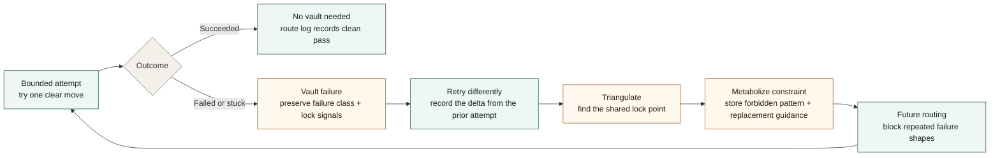

# EF Engine

`EF Engine` is a tiny `Entropy Folding` core for failure-aware routing.

Terminology boundary: in this repository, `entropy`, `folding`,
`metabolization`, and `Eureka Cascade` are local framework terms for search
disorder, failure-to-constraint conversion, and routing improvement. They are
not claims about thermodynamics, biology, cognition, sentience, or magical
insight.

In this operational sense, the system learns: accumulated failure evidence can
change future routing behavior through explicit host-state constraints. This is
not model self-learning, hidden training, consciousness, or personhood.

The mechanism is simple:

- make a bounded attempt
- detect truthful failure or stuckness
- vault the failure as evidence
- retry differently
- triangulate the shared lock point
- metabolize the lesson into a constraint
- route future attempts with better boundaries

That is the whole idea.

## Failure-to-Constraint Loop



## What Entropy Folding Means Here

In this repo, `entropy` means unresolved search disorder:

- too many possible moves
- too many bad retries
- too much ambiguity about what failed

`Folding` means converting that disorder into usable structure:

- failure becomes evidence
- evidence becomes triangulation
- triangulation becomes constraint
- constraint becomes cleaner future routing

## What You Can Copy

This repo is meant to be easy to lift into another project.

The small core surface is:

- `EngineState`
- `AttemptRecord`
- `VaultEntry`
- `RetryDelta`
- `TriangulationSession`
- `ConstraintRecord`
- `RoutingDecision`
- `EngineOutcome`
- `apply_attempt(...)`
- `metabolize_constraint(...)`
- `EngineSaveEnvelope`

If you want the shortest path, copy:

- [engine.rs](src/engine.rs)
- [save.rs](src/save.rs)

and rename the domain nouns to fit your host.

## Minimal Example

```rust
use ef_engine::{
    apply_attempt, metabolize_constraint, AttemptInput, AttemptOutcomeKind, EngineState,
};

let mut state = EngineState::new();

let first = apply_attempt(
    &mut state,
    AttemptInput::new("attempt-a", "direct_patch")
        .with_summary("Tried the direct path")
        .with_outcome(AttemptOutcomeKind::Stuck)
        .with_failure_class("tool_mismatch")
        .with_lock_signal("patch surface missing"),
);

let second = apply_attempt(
    &mut state,
    AttemptInput::new("attempt-b", "smaller_decomposition")
        .with_summary("Retried with a smaller decomposition")
        .with_outcome(AttemptOutcomeKind::Failed)
        .with_failure_class("tool_mismatch")
        .with_lock_signal("patch surface missing")
        .with_retry_parent(&first.attempt_id),
);

let vault_id = second.vault_entry_id.expect("failure should be vaulted");
let constraint = metabolize_constraint(&mut state, &vault_id, "avoid direct patching when patch surface is missing")
    .expect("vault should metabolize");

assert_eq!(constraint.failure_class, "tool_mismatch");
```

## Good Uses

- coding or patch routing
- workflow recovery
- experiment loops
- local-first agent orchestration
- bounded retry systems

## Fastest Inspection Path

If you want to understand the repo quickly, use this order:

1. read [docs/00_core_idea.md](docs/00_core_idea.md)
2. run [examples/minimal_failure_host.rs](examples/minimal_failure_host.rs)
3. inspect [examples/vault_state.json](examples/vault_state.json)
4. run [examples/cascade_demo.rs](examples/cascade_demo.rs)
5. inspect [examples/cascade_state.json](examples/cascade_state.json)

## Where To Read Next

- [ENTROPY_FOLDING_FAILURE_VAULT_TRIANGULATION_LOOP.md](ENTROPY_FOLDING_FAILURE_VAULT_TRIANGULATION_LOOP.md)
- [EUREKA_CASCADE_EFFECT.md](EUREKA_CASCADE_EFFECT.md)
- [docs/00_core_idea.md](docs/00_core_idea.md)
- [docs/01_drop_in_guide.md](docs/01_drop_in_guide.md)
- [docs/02_use_cases.md](docs/02_use_cases.md)
- [GLOSSARY.md](GLOSSARY.md)
- [examples/minimal_failure_host.rs](examples/minimal_failure_host.rs)
- [examples/cascade_demo.rs](examples/cascade_demo.rs)
- [examples/vault_state.json](examples/vault_state.json)
- [examples/cascade_state.json](examples/cascade_state.json)
- [tests/generic_core.rs](tests/generic_core.rs)

## Repo Layout

```text
ef-engine/
  docs/
  examples/
  src/
  tests/
  Cargo.toml
  README.md
  GLOSSARY.md
  CHANGELOG.md
  LICENSE
```

## License

This repo is distributed under the `GNU Affero General Public License v3.0`.

See [LICENSE](LICENSE).
